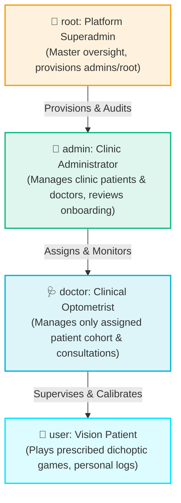

# User Levels, Scopes & Security Architecture

LazyEye enforces **strict role-based access control (RBAC)** and **clinical data isolation**. Each user type has a tailored landing page, dedicated user experience, and strictly segregated data permissions.

---

## User Roles Hierarchy

---

## Detailed User Levels Specification

### 1. Vision Therapy Patient (`user`)
- **Target User**: Child or adult patient undergoing amblyopia / binocular vision rehabilitation under clinical prescription.
- **Dedicated Landing Page**: `PatientHomeScreen`
- **Permitted Features**:
  - **Daily Regimen Card**: View today's prescribed training time (e.g. 20 mins), completed minutes (e.g. 14 mins), and percent completion progress bar.
  - **Single Primary Action Button**: One-tap "Start Daily Session" launching prescribed dichoptic game session.
  - **Dichoptic Anaglyph Status**: View current Left Eye (OS) and Right Eye (OD) chromatic filters (e.g., Red-Cyan) and access the **Lens Calibration** screen.
  - **Prescribed Therapy Games**: Play all 11 clinical vision therapy games via the responsive `GameWebView` (Snake Macular Fixation, Flappy Bird, Menja 3D Slicing, Tetris Fusion, Bubble Shooter, Ping-Pong 3D, Sticky Holds, Maze Labyrinth, Ball Catcher, Bouncing Ball, Bricks Breaker) with gesture pass-through and Red/Cyan chromatic separation.
  - **Therapy Records (`TherapyHistoryScreen`)**: View personal session logs, scores, minutes logged, and supervising doctor's clinical remarks.
- **Security & Privacy Restrictions**:
  - **Strict Self-Isolation**: Can **only** see their own profile, calibration, and session logs.
  - Cannot access any administrative functions, doctor notes for other patients, or other user accounts.

---

### 2. Clinical Optometrist / Doctor (`doctor`)
- **Target User**: Licensed eye care professional (Optometrist / Ophthalmologist) prescribing and monitoring vision therapy.
- **Dedicated Landing Page**: `DoctorDashboardScreen`
- **Permitted Features**:
  - **Assigned Cohort Management**: View list of pediatric patients specifically assigned under their clinical supervision (e.g., `Abhishek Pal`, `Riya Jaiwal`).
  - **Clinical Privacy Scope Banner**: Explicit notice highlighting that access is limited strictly to their assigned cohort.
  - **Patient Lens Calibration (`PatientDetailScreen`)**: Independently calibrate the patient's Left Eye (OS) and Right Eye (OD) filter colors and contrast levels (0–255) to neutralize suppression scotomas, and set daily regimen duration.
  - **84-Day Activity Heatmap (`HeatmapModalScreen`)**: Interactive 12-week heatmap visualization of patient compliance, sessions played, total therapy minutes, and day-by-day logs.
  - **Clinical Evaluation Form (`NewConsultationScreen`)**: Log compliance ratings (Excellent, Good, Moderate, Low), write clinical assessment notes, and prescribe updated daily goals.
- **Security & Privacy Restrictions**:
  - **No Cross-Doctor Visibility**: A doctor **cannot** see other doctors or their credentials.
  - **No Cross-Patient Visibility**: A doctor **cannot** view, calibrate, or inspect patients outside their assigned cohort.
  - Cannot access system administration, billing, or platform configurations.

---

### 3. Clinic Administrator (`admin`)
- **Target User**: Clinic manager or healthcare administrator responsible for clinic operations and onboarding.
- **Dedicated Landing Page**: `AdminDashboardScreen`
- **Permitted Features**:
  - **Clinic Operations Overview**: Real-time KPI metrics displaying total enrolled patients, practicing optometrists, applicant queue, and average clinic adherence.
  - **Patient Directory Tab**: Comprehensive list of all patients enrolled in the clinic, their assigned supervising doctors, daily prescribed regimens, and contact details.
  - **Doctor Directory Tab**: Directory of all optometrists operating within the clinic.
  - **Applicant Approval Queue (`RegistrationApprovalsScreen`)**: Review new patient registration requests and approve/enroll them into active therapy status.
- **Security & Privacy Restrictions**:
  - **No Cross-Admin Visibility**: An administrator **cannot** view, edit, or manage other administrators.
  - **No Superadmin Visibility**: An administrator **cannot** view or modify `root` superadmin accounts.
  - **No Clinical Modification**: Administrators manage account provisioning and status, but do not alter clinical prescription contrast matrices.

---

### 4. Master Platform Superadmin (`root`)
- **Target User**: Master system administrator or IT engineering owner.
- **Dedicated Landing Page**: `RootSuperadminScreen`
- **Permitted Features**:
  - **Master Platform Authority Banner**: System oversight indicator.
  - **Administrator Provisioning**: Provision new `admin` and `root` accounts with custom full names, usernames, and system emails.
  - **Global Administrators Roster**: Review all active administrators across the ecosystem and their access tiers.
  - **Global System Health**: Monitor database synchronization (Clever Cloud + SQLite local cache), aggregated cross-clinic therapy session volumes, and API latencies.
- **Security & Privacy Restrictions**:
  - Master tier. Exclusively authorized to create new administrative accounts.

---

## Role Permissions Matrix

| Capability | Patient (`user`) | Doctor (`doctor`) | Clinic Admin (`admin`) | Superadmin (`root`) |
| :--- | :---: | :---: | :---: | :---: |
| Play Dichoptic Therapy Games |  Yes |  No |  No |  No |
| Personal Glasses Calibration |  Yes |  No |  No |  No |
| View Personal Therapy Records |  Yes |  No |  No |  No |
| View Assigned Patients Cohort |  No |  Yes |  Yes (All Clinic) |  Yes |
| Calibrate Patient Lens Contrast |  No |  Yes (Cohort only) |  No |  No |
| Log Clinical Consultations |  No |  Yes (Cohort only) |  No |  No |
| View 84-Day Activity Heatmaps |  No |  Yes (Cohort only) |  No |  No |
| View Other Doctors |  No |  No |  Yes (Clinic only) |  Yes |
| View Other Admins |  No |  No |  No |  Yes |
| Approve Registration Applicants |  No |  No |  Yes |  Yes |
| Provision New Administrators |  No |  No |  No |  Yes |
| Monitor Global Platform Health |  No |  No |  No |  Yes |

---

## Quick Testing Switcher Accounts

The login screen and profile drawer include a verified 1-tap quick role switcher to test permissions seamlessly:

| Role | Username | Password | Purpose |
| :--- | :--- | :--- | :--- |
| **`doctor`** | `dr_sarah` | `doctor123` | Tests assigned patient cohort, lens calibration, consultation logging, and 84-day heatmaps. |
| **`admin`** | `admin` | `admin123` | Tests clinic patient roster, doctor roster, and applicant approval queue. |
| **`patient`** | `abhi8535` | `9870` | Tests patient dashboard, daily regimen, 11-game WebView therapy suite, and personal history. |
| **`root`** | `root` | `root123` | Tests master console, administrator provisioning, and platform health telemetry. |

